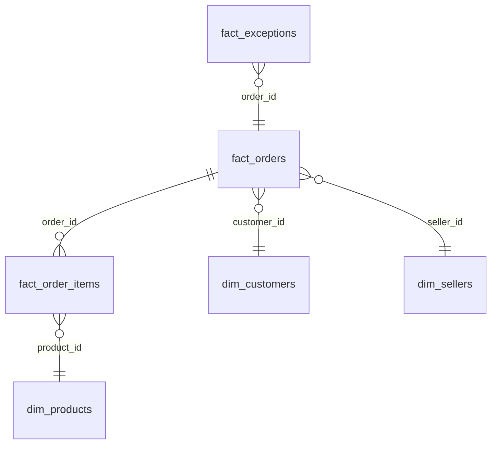

# Power BI Dashboard Specification

## Page 1: Executive Summary
- **KPI Cards**: Inventory Turns, Avg Days on Hand, OTD %, Fill Rate %, Avg Cycle Time (days), Exception Count
- **Monthly Trend Line Chart**: Cycle time and OTD % over time
- **Data Source**: `fact_kpi_summary.csv`, `fact_orders.csv`

## Page 2: Cycle Time Analysis
- **Histogram**: Distribution of `cycle_time_days` (bins of 2 days)
- **Table**: Percentile breakdown (p50, p75, p90, p95, p99)
- **Bar Chart**: Avg cycle time by product category (top 15)
- **Slicer**: Date range, seller state
- **Data Source**: `fact_orders.csv`, `dim_products.csv`

## Page 3: Exception Monitor
- **KPI Cards**: Total exceptions, Critical count, Warning count
- **Stacked Bar Chart**: Exception count by type and severity
- **Table**: Exception detail with drill-through (exception_id, type, severity, order_id, description)
- **Trend**: Exceptions detected per week
- **Slicer**: Severity, exception_type, source_system
- **Data Source**: `fact_exceptions.csv`

## Page 4: ABC Slotting & Inventory
- **Treemap**: Revenue by ABC class
- **Table**: Top 20 A-class products with revenue, turns, days on hand
- **Donut Chart**: Product count by ABC class
- **Bar Chart**: Avg days on hand by ABC class
- **Data Source**: `fact_order_items.csv`, `dim_products.csv`, `fact_kpi_summary.csv`

## DAX Measures
```dax
Total Exceptions = COUNTROWS(fact_exceptions)
Avg Cycle Time = AVERAGE(fact_orders[cycle_time_days])
OTD Percentage = DIVIDE(
    CALCULATE(COUNTROWS(fact_orders), fact_orders[on_time] = TRUE()),
    COUNTROWS(fact_orders)
)
```

## Data Model Relationships

